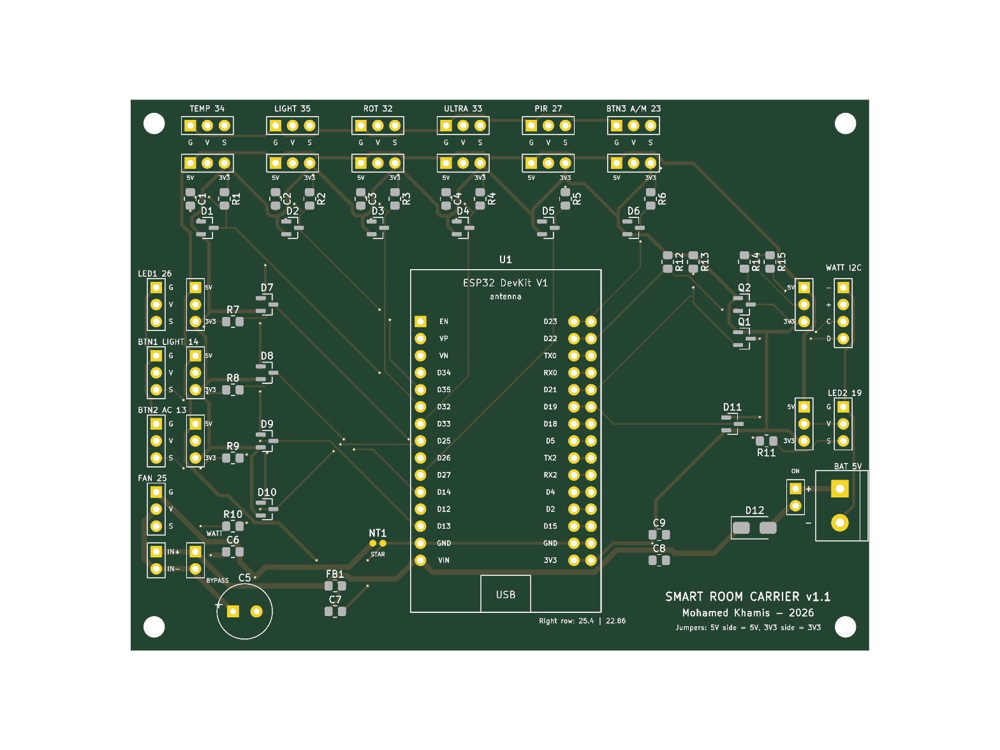

# Smart Room carrier board (KiCad)

Author: Mohamed Khamis

A 110 × 82 mm two-layer carrier board for the ESP32 DevKit V1 (30-pin) and the DFRobot Gravity modules in [docs/esp32-wiring.md](../../docs/esp32-wiring.md). The DevKit plugs into two 1×15 female headers, and every module plugs into its own 3-pin header with the pin numbers from `firmware/main/board_pins.h`.

Checked with KiCad 10.0.6: ERC 0 errors and 0 warnings, DRC 0 violations, 0 unconnected items, 0 schematic/board mismatches ([erc.rpt](erc.rpt), [drc.rpt](drc.rpt)).

## Files

| File | What it is |
|---|---|
| `smart-room-carrier.kicad_pro` | KiCad project (open this one) |
| `smart-room-carrier.kicad_sch` | Schematic |
| `smart-room-carrier.kicad_pcb` | Board, placed and routed, with a GND pour on the bottom layer |
| `SmartRoom.kicad_sym`, `SmartRoom.pretty/` | Project symbol and footprint libraries |
| `smart-room-carrier-schematic.pdf` | Schematic as PDF |
| `gerbers/`, `smart-room-carrier-gerbers.zip` | Gerber and drill files for ordering the board (upload the zip to JLCPCB, PCBWay, etc.) |
| `render-top.png`, `render-bottom.png` | 3D renders of both sides |
| `erc.rpt`, `drc.rpt` | KiCad check reports |
| `gen/` | Python scripts that generate the project (`python gen/build.py`) |
| `preview.svg` | Quick picture of the routed board |

## Connectors

Every module header is **G V S** (GND, VCC, signal), printed on the board next to the pins. With a Gravity-to-Dupont cable: black to G, red to V, green or blue to S.

| Header | Module | ESP32 pin | VCC default |
|---|---|---|---|
| J1 TEMP | DFR0023 LM35 | GPIO34 | **5V** (the LM35 needs at least 4 V) |
| J2 LIGHT | DFR0026 | GPIO35 | 3V3 |
| J3 ROT | DFR0058 | GPIO32 | 3V3 |
| J4 ULTRA | SEN0307 | GPIO33 | 3V3 |
| J5 PIR | SEN0018 | GPIO27 | 3V3 |
| J6 BTN3 A/M | DFR0029 | GPIO23 | 3V3 |
| J7 LED1 | DFR0021 | GPIO26 | 3V3 |
| J8 BTN1 LIGHT | DFR0029 | GPIO14 | 3V3 |
| J9 BTN2 AC | DFR0029 | GPIO13 | 3V3 |
| J10 FAN | DFR0411 | GPIO25 | metered 5 V (fixed) |
| J11 LED2 | DFR0021 | GPIO19 | 3V3 |
| J12 WATT I2C (− + C D) | SEN0291 data side | SCL GPIO22, SDA GPIO21 | 3V3 |
| J13 WATT IN+/IN− | SEN0291 screw terminals | – | IN+ = VIN 5 V, IN− = fan 5 V |
| J14 BAT 5V | 5 V battery (screw terminal, + and −) | – | – |

## Choosing 5 V or 3.3 V for a module

Each module (except the fan) has a 3-pin jumper header labelled **5V** and **3V3** at its ends. The middle pin is the module's VCC.

- Jumper cap on the **5V** end and the middle pin: the module runs on 5 V.
- Jumper cap on the middle pin and the **3V3** end: the module runs on 3.3 V.

Moving a module to 5 V is safe for the ESP32: every signal goes through a series resistor (1 kΩ for inputs, 220 Ω for outputs) and a BAT54S clamp to GND and 3V3, so the GPIO can't go above about 3.6 V. The wattmeter's I2C lines go through a BSS138 level shifter, so it works on either supply. Keep in mind that an analog module on 5 V can output more than 3.3 V, and readings above about 3.1 V are clipped by the ESP32's ADC.

## Power and ground

- **Fan path:** VIN (5 V) → J13 IN+ → SEN0291 → J13 IN− → fan VCC. The wattmeter therefore measures the fan. Without the wattmeter, put a jumper cap on **JP12 BYPASS**; take it off again when the wattmeter is connected, or the meter is bypassed.
- **Fan decoupling:** C5 (470 µF) and C6 (100 nF) sit next to the fan header to absorb motor current spikes.
- **Star ground:** the fan's ground (GND_FAN) is a separate net that only joins logic GND at NT1, right next to the DevKit's GND pin. Motor return current doesn't flow through the sensor and I2C ground.
- **Sensor 5 V:** the 5 V for the module jumpers (+5V_S) is filtered from VIN by ferrite bead FB1 and C7, so fan noise stays off the sensor supply.

## Running from a battery

The board runs from the DevKit's USB port, from a 5 V battery on **J14 BAT 5V**, or from both at once.

- **Which batteries:** anything that gives a steady 5 V (a power bank with bare wires, a 5 V regulator) or 4× AA NiMH (4.8 V). Don't use 4× AA alkaline (6 V when fresh): the fan and any module jumpered to 5V would get 6 V. A single Li-ion cell (3.7 V) needs a 5 V boost converter in front of J14.
- **On/off:** **JP13 BAT ON** sits between the terminal and the board. Put a jumper cap on it to run from the battery, or wire an on/off switch to its two pins.
- **Protection:** the battery reaches the 5 V rail (VIN) through D12, an SS34 Schottky diode. If the battery is connected backwards, the diode blocks it. With USB plugged in as well, the diode stops USB from charging or back-feeding the battery.
- **Voltage drop:** the diode drops about 0.3 V, so on a 5 V battery the rail sits around 4.7 V. Everything works at that, including the LM35 (needs at least 4 V). The fan runs slightly slower.
- **Run time:** the board draws roughly 100–150 mA with the fan off and a few hundred mA with the fan on. A 2000 mAh NiMH pack lasts about 10–15 hours with the fan mostly off.

## DevKit header spacing

30-pin DevKit V1 boards come with the two pin rows either 25.4 mm (1.0") or 22.86 mm (0.9") apart. The right-hand row has holes for both. Measure your board, solder the right-hand female header into the row that fits, and leave the other row empty.

## Bill of materials

| Ref | Qty | Part |
|---|---|---|
| U1 | 2 | 1×15 female header, 2.54 mm (socket for the DevKit) |
| J1–J11 | 11 | 1×03 male header, 2.54 mm |
| J12 | 1 | 1×04 male header, 2.54 mm |
| J13 | 1 | 1×02 male header, 2.54 mm |
| J14 | 1 | 2-pin screw terminal, 5.08 mm |
| JP1–JP11 | 11 | 1×03 male header + jumper cap |
| JP12, JP13 | 2 | 1×02 male header + jumper cap (JP13 can take an external switch instead) |
| R1–R11 | 11 | 0805 resistor: 1 kΩ for inputs, 220 Ω for LED1, LED2 and FAN |
| R12–R15 | 4 | 0805 resistor 4.7 kΩ (I2C pull-ups) |
| D1–D11 | 11 | BAT54S, SOT-23 |
| D12 | 1 | SS34 Schottky diode, SMA (3 A, 40 V) |
| Q1, Q2 | 2 | BSS138, SOT-23 |
| C1–C4 | 4 | 0805 10 nF (analog inputs) |
| C5 | 1 | 470 µF 10 V electrolytic, D8 mm, 3.5 mm pitch |
| C6, C9 | 2 | 0805 100 nF |
| C7, C8 | 2 | 0805 10 µF 16 V |
| FB1 | 1 | 0805 ferrite bead, 600 Ω @ 100 MHz, at least 500 mA |
| H1–H4 | 4 | M3 mounting holes |

## Regenerating

`python gen/build.py` rewrites the schematic, board, libraries and preview from `gen/design.py`. Hand edits made in KiCad are overwritten, so once you start editing the board in KiCad, stop using the script.
